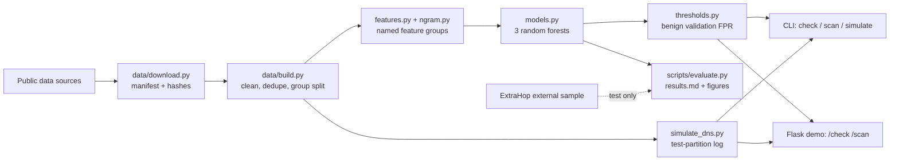

# Architecture

DomainGuard is a text-only scoring pipeline. Nothing in the scoring path makes
a network request: the public suffix list is bundled with `tldextract`, and no
DNS, HTTP or WHOIS lookup is performed on submitted strings.

## Components

| Component | Purpose |
|---|---|
| `normalize.py` | One canonical parser (host, registered domain, SLD, TLD, path, query, flags). Never raises. |
| `features.py` | Fixed-order numeric features in named groups so ablations can drop a group. |
| `ngram.py` | Add-one-smoothed character trigram score; out-of-fold for benign training rows. |
| `models.py` | Train/save/load/score three random forests. Artifacts store feature order, thresholds and metadata sidecars. |
| `thresholds.py` | 1% and 0.1% FPR thresholds chosen on benign validation scores; flag when `score >= threshold`. |
| `dga/generators.py` | Five output-shape families, seeded and collision-checked against benign data. |
| `dga/evasion_generators.py` | Evaluation-only string recipes. |
| `data/download.py` | Idempotent source downloads with a manifest (URL, time, size, SHA-256, rows, commit dates). |
| `data/build.py` | Cleaning, Tranco overlap removal, free-host flags, grouped 70/15/15 splits. |
| `data/simulate_dns.py` | Labelled Zeek TSV log built only from held-out test domains. |
| `scanner/` | Streaming Zeek TSV/JSON and CSV parsers; client ranking with a minimum-evidence rule. |
| `web/` | Two-page Flask demo with CSRF tokens and a 20 MB upload cap. |

## Models

| Name | Input | Feature groups | Role |
|---|---|---|---|
| `phish_host` | Host-level URL features | length, charstats, keywords, brand, ngram, subdomain, flags | Primary deployed model |
| `phish_full` | Host + path/query | all groups above plus path | Comparison model; path confound warning |
| `dga` | Second-level label only (no TLD) | length, charstats, ngram | DGA detection and external test alignment |

## Data flow notes

- Splits are grouped by registered domain: a domain cannot appear in both train
  and test.
- The DGA benign side is drawn from the Tranco train partition; the ExtraHop
  dataset is used only as an external test and never touches training.
- NXDOMAIN rate is computed by the scanner for display only. It is not a
  feature, not part of ranking, and not part of any accuracy number.
- Uploaded DNS logs are processed in a temporary directory that is removed
  before the response is returned.
