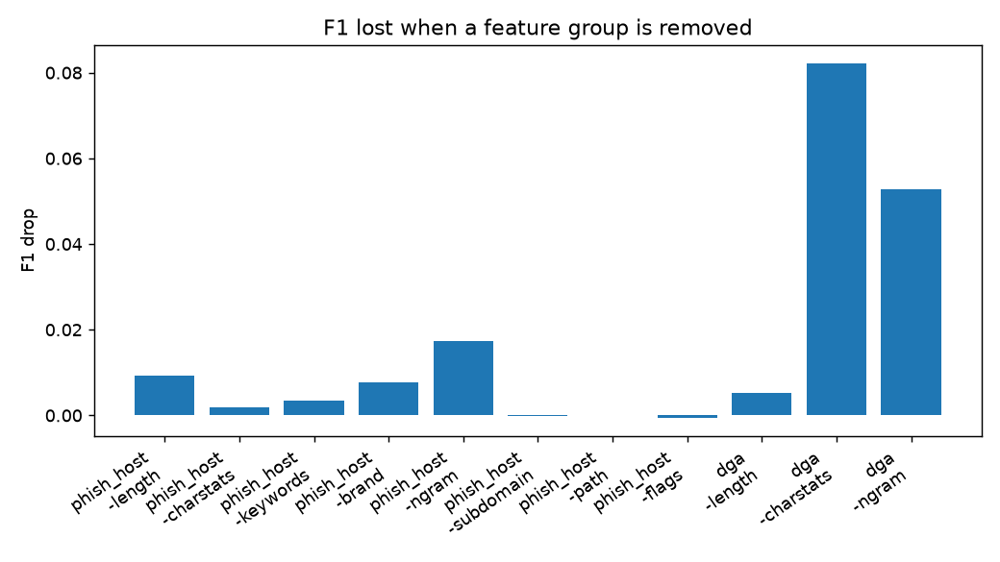
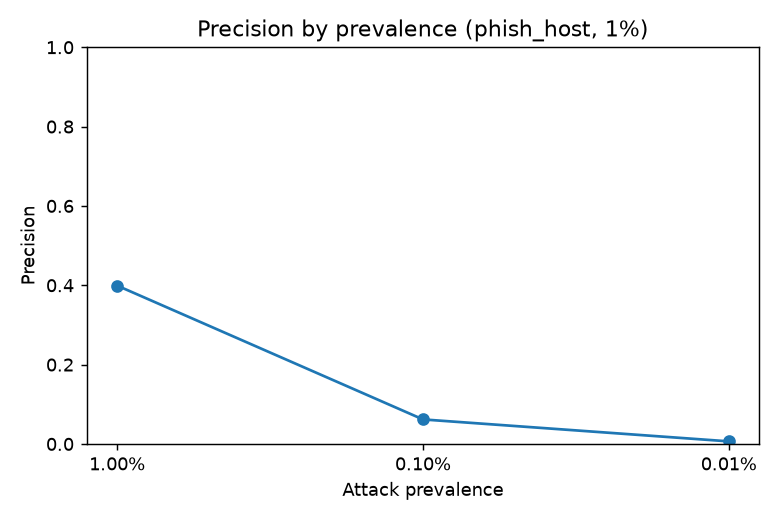
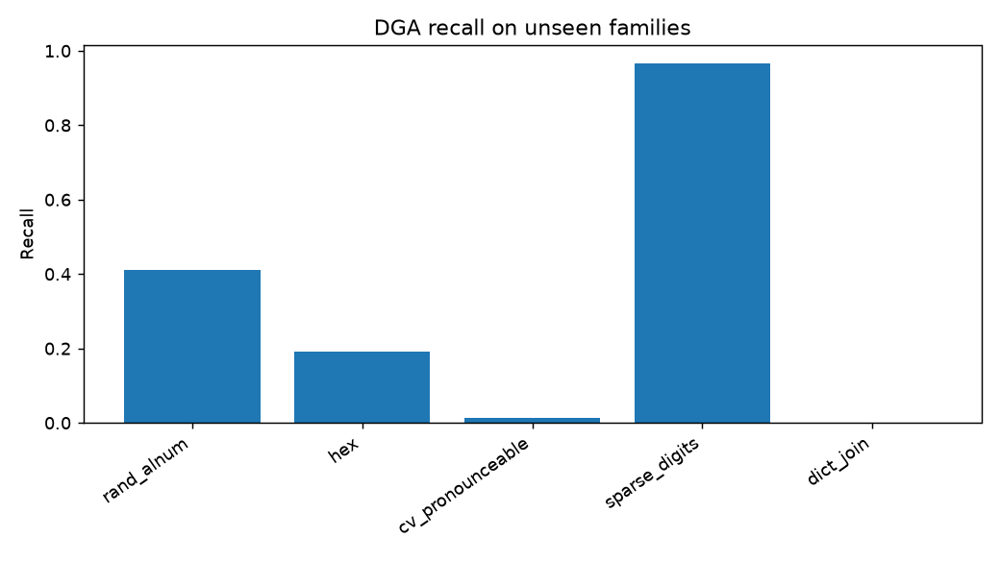

# DomainGuard results

Generated 2026-11-24T04:59:28.496400+00:00 by `scripts/evaluate.py`.

## Run metadata

| Item | Value |
|---|---|
| Git commit | a3348d1044f6ece48adf75591f6d84b3cfed7e84 |
| Data manifest SHA-256 | 8c59af430b08993ca3abe2bdd1d8411836eec9a3daf5e9e96e2f4d87c068bc2d |
| Tranco list ID | 8PW6V |
| Manifest download dates | extrahop: 2026-11-23, openphish: 2026-11-23, phishing_db_domains: 2026-11-23, phishing_db_links: 2026-11-23, tranco: 2026-11-23 |
| Python | 3.14.7 |
| scikit-learn | 1.9.1 |
| pandas | 3.1.1 |
| numpy | 2.5.5 |
| Seeds | 42, 43, 44, 45, 46 |
| Runtime (seconds) | 20014.3 |
| Dataset sizes | {"test": {"dga_benign": 22500, "dga_malicious": 22500, "phish_benign": 22500, "phish_malicious": 22500}, "train": {"dga_benign": 105000, "dga_malicious": 105000, "phish_benign": 105000, "phish_malicious": 105000}, "val": {"dga_benign": 22500, "dga_malicious": 22500, "phish_benign": 22500, "phish_malicious": 22500}} |
| Phishing overlap removed | 4349 |
| DGA collisions discarded | 0 |

## Data notes

The historical `ALL-phishing-links.lst` was unavailable (HTTP 503 on the official mirror and absent from the GitHub repository); the ACTIVE Phishing.Database files were used instead. Unique phishing rows before cleaning: 339394; duplicates removed: 26778; benign overlap removed: 4349; free-host rows in the split: 0.

## 11.1 Main metrics (test split)

Values are mean ± standard deviation over the configured seeds. Thresholds were set on benign validation scores only. Proposal targets: phishing F1 above 0.95 at about 1% FPR; DGA at about 1% FPR.

### phish_host — threshold_1pct

| Precision | Recall | F1 | AUC | FPR | TP | FP | TN | FN | Threshold | Validation FPR |
|---|---|---|---|---|---|---|---|---|---|---|
| 0.9850 ± 0.0003 | 0.6879 ± 0.0005 | 0.8101 ± 0.0003 | 0.9222 ± 0.0001 | 0.0105 ± 0.0002 | 15477.2000 ± 11.8051 | 235.4000 ± 5.3516 | 22264.6000 ± 5.3516 | 7022.8000 ± 11.8051 | 0.7001 | 0.0100 |

### phish_host — threshold_0p1pct

| Precision | Recall | F1 | AUC | FPR | TP | FP | TN | FN | Threshold | Validation FPR |
|---|---|---|---|---|---|---|---|---|---|---|
| 0.9985 ± 0.0001 | 0.6270 ± 0.0010 | 0.7703 ± 0.0007 | 0.9222 ± 0.0001 | 0.0009 ± 0.0001 | 14106.4000 ± 21.6666 | 20.8000 ± 1.9391 | 22479.2000 ± 1.9391 | 8393.6000 ± 21.6666 | 0.8569 | 0.0010 |

### phish_full — threshold_1pct

| Precision | Recall | F1 | AUC | FPR | TP | FP | TN | FN | Threshold | Validation FPR |
|---|---|---|---|---|---|---|---|---|---|---|
| 0.9850 ± 0.0003 | 0.6859 ± 0.0006 | 0.8087 ± 0.0004 | 0.9216 ± 0.0001 | 0.0105 ± 0.0002 | 15433.6000 ± 14.6096 | 235.8000 ± 5.0754 | 22264.2000 ± 5.0754 | 7066.4000 ± 14.6096 | 0.6898 | 0.0100 |

### phish_full — threshold_0p1pct

| Precision | Recall | F1 | AUC | FPR | TP | FP | TN | FN | Threshold | Validation FPR |
|---|---|---|---|---|---|---|---|---|---|---|
| 0.9983 ± 0.0001 | 0.6281 ± 0.0008 | 0.7711 ± 0.0006 | 0.9216 ± 0.0001 | 0.0011 ± 0.0001 | 14133.2000 ± 17.7471 | 24.2000 ± 1.9391 | 22475.8000 ± 1.9391 | 8366.8000 ± 17.7471 | 0.8393 | 0.0010 |

### dga — threshold_1pct

| Precision | Recall | F1 | AUC | FPR | TP | FP | TN | FN | Threshold | Validation FPR |
|---|---|---|---|---|---|---|---|---|---|---|
| 0.9873 ± 0.0003 | 0.8064 ± 0.0021 | 0.8877 ± 0.0012 | 0.9838 ± 0.0000 | 0.0104 ± 0.0003 | 18143.8000 ± 47.1440 | 233.8000 ± 5.8788 | 22266.2000 ± 5.8788 | 4356.2000 ± 47.1440 | 0.8502 | 0.0100 |

### dga — threshold_0p1pct

| Precision | Recall | F1 | AUC | FPR | TP | FP | TN | FN | Threshold | Validation FPR |
|---|---|---|---|---|---|---|---|---|---|---|
| 0.9988 ± 0.0002 | 0.6249 ± 0.0071 | 0.7688 ± 0.0053 | 0.9838 ± 0.0000 | 0.0008 ± 0.0001 | 14059.6000 ± 159.3745 | 17.0000 ± 3.0332 | 22483.0000 ± 3.0332 | 8440.4000 ± 159.3745 | 0.9938 | 0.0010 |

## 11.2 Ablations (seed 42, threshold_1pct)

| Model | Dropped group | F1 | F1 drop | FPR | FPR change |
|---|---|---|---|---|---|
| phish_host | length | 0.8008 | +0.0092 | 0.0110 | +0.0004 |
| phish_host | charstats | 0.8081 | +0.0020 | 0.0105 | -0.0000 |
| phish_host | keywords | 0.8065 | +0.0035 | 0.0105 | -0.0000 |
| phish_host | brand | 0.8023 | +0.0078 | 0.0107 | +0.0002 |
| phish_host | ngram | 0.7927 | +0.0174 | 0.0106 | +0.0000 |
| phish_host | subdomain | 0.8102 | -0.0001 | 0.0108 | +0.0003 |
| phish_host | path | 0.8100 | +0.0000 | 0.0105 | +0.0000 |
| phish_host | flags | 0.8107 | -0.0007 | 0.0105 | +0.0000 |
| dga | length | 0.8817 | +0.0053 | 0.0106 | +0.0001 |
| dga | charstats | 0.8048 | +0.0822 | 0.0104 | -0.0001 |
| dga | ngram | 0.8341 | +0.0529 | 0.0145 | +0.0040 |

## 11.3 Prevalence-aware precision

Computed from measured test recall and FPR, not measured directly.

| Model | Threshold | Prevalence | Precision | Recall | FPR |
|---|---|---|---|---|---|
| phish_host | 1pct | 1.00% | 0.3991 | 0.6879 | 0.0105 |
| phish_host | 1pct | 0.10% | 0.0618 | 0.6879 | 0.0105 |
| phish_host | 1pct | 0.01% | 0.0065 | 0.6879 | 0.0105 |
| phish_host | 0p1pct | 1.00% | 0.8726 | 0.6270 | 0.0009 |
| phish_host | 0p1pct | 0.10% | 0.4044 | 0.6270 | 0.0009 |
| phish_host | 0p1pct | 0.01% | 0.0635 | 0.6270 | 0.0009 |
| phish_full | 1pct | 1.00% | 0.3980 | 0.6859 | 0.0105 |
| phish_full | 1pct | 0.10% | 0.0615 | 0.6859 | 0.0105 |
| phish_full | 1pct | 0.01% | 0.0065 | 0.6859 | 0.0105 |
| phish_full | 0p1pct | 1.00% | 0.8551 | 0.6281 | 0.0011 |
| phish_full | 0p1pct | 0.10% | 0.3689 | 0.6281 | 0.0011 |
| phish_full | 0p1pct | 0.01% | 0.0552 | 0.6281 | 0.0011 |
| dga | 1pct | 1.00% | 0.4394 | 0.8064 | 0.0104 |
| dga | 1pct | 0.10% | 0.0721 | 0.8064 | 0.0104 |
| dga | 1pct | 0.01% | 0.0077 | 0.8064 | 0.0104 |
| dga | 0p1pct | 1.00% | 0.8931 | 0.6249 | 0.0008 |
| dga | 0p1pct | 0.10% | 0.4529 | 0.6249 | 0.0008 |
| dga | 0p1pct | 0.01% | 0.0764 | 0.6249 | 0.0008 |

## 11.4 Leave-one-family-out DGA

Trained on four families, tested on the held-out family at the full model's validation threshold. FPR on benign test rows is roughly constant.

| Held out | Train rows | Held-out test rows | Recall | Benign FPR | Threshold |
|---|---|---|---|---|---|
| rand_alnum | 167906 | 4484 | 0.4101 | 0.0102 | 0.8531 |
| hex | 168386 | 4564 | 0.1908 | 0.0127 | 0.8531 |
| cv_pronounceable | 167782 | 4444 | 0.0131 | 0.0090 | 0.8531 |
| sparse_digits | 168030 | 4513 | 0.9663 | 0.0127 | 0.8531 |
| dict_join | 167896 | 4495 | 0.0011 | 0.0072 | 0.8531 |
| average | - | - | 0.3163 | - | 0.8531 |

## 11.5 External real-data test (ExtraHop, test only)

Balanced fixed-seed sample: 200000 rows (100000 per class). Not used for training or tuning.

| Metric | Value |
|---|---|
| DGA recall | 0.2137 |
| Benign FPR | 0.0201 |
| Threshold | 0.8531 |
| Source rows read | 16246006 |
| Source lines read | 16246006 |

Flagged external benign names by simple shape:

| Shape | Rows | Flagged | Flag rate |
|---|---|---|---|
| random-looking | 97480 | 1998 | 0.0205 |
| word-like | 2520 | 14 | 0.0056 |

## 11.6 Evasion tests

### URL rewrites on phishing test rows

Detection rate uses the 1% threshold of `phish_host` (seed 42).

| Transform | Before | After | Drop |
|---|---|---|---|
| percent | 0.6705 | 0.6705 | 0.0000 |
| case | 0.6705 | 0.6705 | 0.0000 |
| subdomain | 0.6705 | 1.0000 | -0.3295 |
| path | 0.6705 | 1.0000 | -0.3295 |
| hyphen | 0.6705 | 0.7005 | -0.0300 |
| homoglyph | 0.6705 | 0.6565 | 0.0140 |

### Dictionary-style DGAs

| Evasion family | Recall |
|---|---|
| dict_join_hyphen | 0.0000 |
| dict_join_digits | 0.0140 |
| dict_join_three | 0.4620 |
| rand_alnum_syllable | 0.0090 |

## 11.7 Scanner on simulated DNS traffic

Measured on a labelled simulated log generated from the test partition (`simulate_dns.py`, fixed seed). Scanner uses the strict 0.1% thresholds; NXDOMAIN is display-only. These are simulated-traffic numbers, not real-world accuracy.

| Metric | Value |
|---|---|
| Clients / infected clients | 40 / 20 |
| Ranked clients (min flags = 3) | 10 |
| Client TP / FP / FN / TN | 10 / 0 / 10 / 20 |
| Client precision | 1.0000 |
| Client recall | 0.5000 |
| Flagged / true malicious domains | 49 / 1190 |
| Domain precision | 0.9592 |
| Domain recall | 0.0395 |

## Figures

- [ROC curves](figures/roc.png)
- [Ablation F1 drops](figures/ablation_f1_drop.png)
- [Leave-one-family-out recall](figures/lofo_recall.png)
- [Evasion detection rate](figures/evasion_detection_rate.png)
- [Precision by prevalence](figures/precision_by_prevalence.png)
