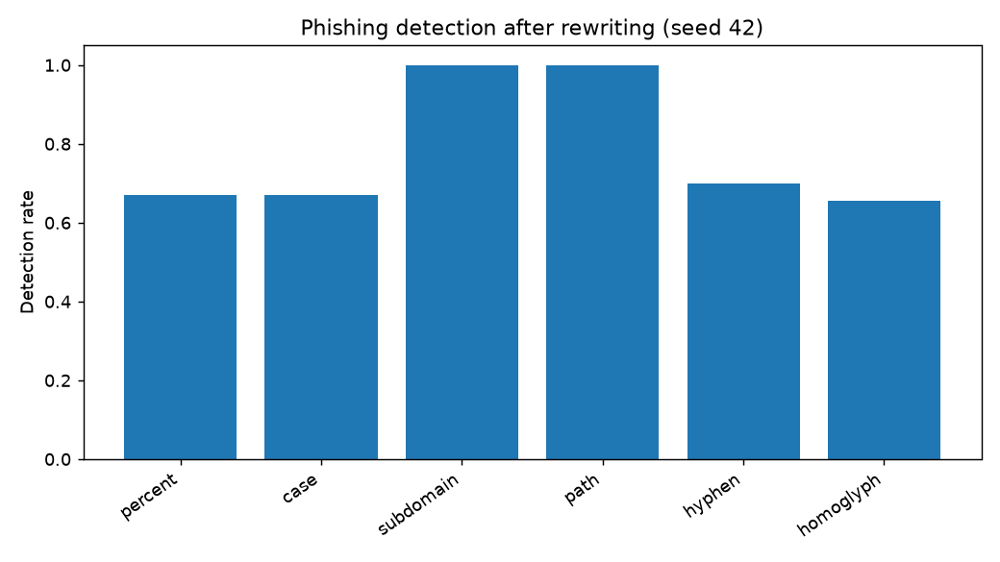

# DomainGuard results

Generated 2026-11-23T22:48:08.283123+00:00 by `scripts/evaluate.py`.

## Run metadata

| Item | Value |
|---|---|
| Git commit | not available in this run |
| Data manifest SHA-256 | 8c59af430b08993ca3abe2bdd1d8411836eec9a3daf5e9e96e2f4d87c068bc2d |
| Tranco list ID | 8PW6V |
| Manifest download dates | extrahop: 2026-11-23, openphish: 2026-11-23, phishing_db_domains: 2026-11-23, phishing_db_links: 2026-11-23, tranco: 2026-11-23 |
| Python | 3.14.7 |
| scikit-learn | 1.9.1 |
| pandas | 3.1.1 |
| numpy | 2.5.5 |
| Seeds | 42 |
| Runtime (seconds) | 385.0 |
| Dataset sizes | {"test": {"dga_benign": 22500, "dga_malicious": 22500, "phish_benign": 22500, "phish_malicious": 22500}, "train": {"dga_benign": 105000, "dga_malicious": 105000, "phish_benign": 105000, "phish_malicious": 105000}, "val": {"dga_benign": 22500, "dga_malicious": 22500, "phish_benign": 22500, "phish_malicious": 22500}} |
| Phishing overlap removed | 4349 |
| DGA collisions discarded | 0 |

## Data notes

The historical `ALL-phishing-links.lst` was unavailable (HTTP 503 on the official mirror and absent from the GitHub repository); the ACTIVE Phishing.Database files were used instead. Unique phishing rows before cleaning: 339394; duplicates removed: 26778; benign overlap removed: 4349; free-host rows in the split: 0.

## 11.1 Main metrics (test split)

Values are mean ± standard deviation over the configured seeds. Thresholds were set on benign validation scores only. Proposal targets: phishing F1 above 0.95 at about 1% FPR; DGA at about 1% FPR.

### phish_host — threshold_1pct

| Precision | Recall | F1 | AUC | FPR | TP | FP | TN | FN | Threshold | Validation FPR |
|---|---|---|---|---|---|---|---|---|---|---|
| 0.9849 ± 0.0000 | 0.6879 ± 0.0000 | 0.8100 ± 0.0000 | 0.9223 ± 0.0000 | 0.0105 ± 0.0000 | 15478.0000 ± 0.0000 | 237.0000 ± 0.0000 | 22263.0000 ± 0.0000 | 7022.0000 ± 0.0000 | 0.7004 | 0.0100 |

### phish_host — threshold_0p1pct

| Precision | Recall | F1 | AUC | FPR | TP | FP | TN | FN | Threshold | Validation FPR |
|---|---|---|---|---|---|---|---|---|---|---|
| 0.9984 ± 0.0000 | 0.6256 ± 0.0000 | 0.7693 ± 0.0000 | 0.9223 ± 0.0000 | 0.0010 ± 0.0000 | 14077.0000 ± 0.0000 | 22.0000 ± 0.0000 | 22478.0000 ± 0.0000 | 8423.0000 ± 0.0000 | 0.8589 | 0.0010 |

### phish_full — threshold_1pct

| Precision | Recall | F1 | AUC | FPR | TP | FP | TN | FN | Threshold | Validation FPR |
|---|---|---|---|---|---|---|---|---|---|---|
| 0.9849 ± 0.0000 | 0.6849 ± 0.0000 | 0.8079 ± 0.0000 | 0.9217 ± 0.0000 | 0.0105 ± 0.0000 | 15410.0000 ± 0.0000 | 236.0000 ± 0.0000 | 22264.0000 ± 0.0000 | 7090.0000 ± 0.0000 | 0.6903 | 0.0100 |

### phish_full — threshold_0p1pct

| Precision | Recall | F1 | AUC | FPR | TP | FP | TN | FN | Threshold | Validation FPR |
|---|---|---|---|---|---|---|---|---|---|---|
| 0.9982 ± 0.0000 | 0.6289 ± 0.0000 | 0.7716 ± 0.0000 | 0.9217 ± 0.0000 | 0.0012 ± 0.0000 | 14150.0000 ± 0.0000 | 26.0000 ± 0.0000 | 22474.0000 ± 0.0000 | 8350.0000 ± 0.0000 | 0.8367 | 0.0010 |

### dga — threshold_1pct

| Precision | Recall | F1 | AUC | FPR | TP | FP | TN | FN | Threshold | Validation FPR |
|---|---|---|---|---|---|---|---|---|---|---|
| 0.9871 ± 0.0000 | 0.8053 ± 0.0000 | 0.8870 ± 0.0000 | 0.9838 ± 0.0000 | 0.0105 ± 0.0000 | 18119.0000 ± 0.0000 | 236.0000 ± 0.0000 | 22264.0000 ± 0.0000 | 4381.0000 ± 0.0000 | 0.8531 | 0.0100 |

### dga — threshold_0p1pct

| Precision | Recall | F1 | AUC | FPR | TP | FP | TN | FN | Threshold | Validation FPR |
|---|---|---|---|---|---|---|---|---|---|---|
| 0.9990 ± 0.0000 | 0.6212 ± 0.0000 | 0.7661 ± 0.0000 | 0.9838 ± 0.0000 | 0.0006 ± 0.0000 | 13977.0000 ± 0.0000 | 14.0000 ± 0.0000 | 22486.0000 ± 0.0000 | 8523.0000 ± 0.0000 | 0.9940 | 0.0010 |

## 11.2 Ablations (seed 42, threshold_1pct)

| Model | Dropped group | F1 | F1 drop | FPR | FPR change |
|---|---|---|---|---|---|

## 11.3 Prevalence-aware precision

Computed from measured test recall and FPR, not measured directly.

| Model | Threshold | Prevalence | Precision | Recall | FPR |
|---|---|---|---|---|---|
| phish_host | 1pct | 1.00% | 0.3975 | 0.6879 | 0.0105 |
| phish_host | 1pct | 0.10% | 0.0614 | 0.6879 | 0.0105 |
| phish_host | 1pct | 0.01% | 0.0065 | 0.6879 | 0.0105 |
| phish_host | 0p1pct | 1.00% | 0.8660 | 0.6256 | 0.0010 |
| phish_host | 0p1pct | 0.10% | 0.3904 | 0.6256 | 0.0010 |
| phish_host | 0p1pct | 0.01% | 0.0601 | 0.6256 | 0.0010 |
| phish_full | 1pct | 1.00% | 0.3974 | 0.6849 | 0.0105 |
| phish_full | 1pct | 0.10% | 0.0614 | 0.6849 | 0.0105 |
| phish_full | 1pct | 0.01% | 0.0065 | 0.6849 | 0.0105 |
| phish_full | 0p1pct | 1.00% | 0.8461 | 0.6289 | 0.0012 |
| phish_full | 0p1pct | 0.10% | 0.3527 | 0.6289 | 0.0012 |
| phish_full | 0p1pct | 0.01% | 0.0516 | 0.6289 | 0.0012 |
| dga | 1pct | 1.00% | 0.4368 | 0.8053 | 0.0105 |
| dga | 1pct | 0.10% | 0.0714 | 0.8053 | 0.0105 |
| dga | 1pct | 0.01% | 0.0076 | 0.8053 | 0.0105 |
| dga | 0p1pct | 1.00% | 0.9098 | 0.6212 | 0.0006 |
| dga | 0p1pct | 0.10% | 0.4998 | 0.6212 | 0.0006 |
| dga | 0p1pct | 0.01% | 0.0908 | 0.6212 | 0.0006 |

## 11.4 Leave-one-family-out DGA

Trained on four families, tested on the held-out family at the full model's validation threshold. FPR on benign test rows is roughly constant.

| Held out | Train rows | Held-out test rows | Recall | Benign FPR | Threshold |
|---|---|---|---|---|---|

## 11.5 External real-data test (ExtraHop, test only)

Balanced fixed-seed sample: 20000 rows (10000 per class). Not used for training or tuning.

| Metric | Value |
|---|---|
| DGA recall | 0.2132 |
| Benign FPR | 0.0204 |
| Threshold | 0.8531 |
| Source rows read | 16246006 |

Flagged external benign names by simple shape:

| Shape | Rows | Flagged | Flag rate |
|---|---|---|---|
| random-looking | 9749 | 200 | 0.0205 |
| word-like | 251 | 4 | 0.0159 |

## 11.6 Evasion tests

### URL rewrites on phishing test rows

Detection rate uses the 1% threshold of `phish_host` (seed 42).

| Transform | Before | After | Drop |
|---|---|---|---|
| percent | 0.6705 | 0.6705 | 0.0000 |
| case | 0.6705 | 0.6705 | 0.0000 |
| subdomain | 0.6705 | 1.0000 | -0.3295 |
| path | 0.6705 | 1.0000 | -0.3295 |
| hyphen | 0.6705 | 0.7005 | -0.0300 |
| homoglyph | 0.6705 | 0.6565 | 0.0140 |

### Dictionary-style DGAs

| Evasion family | Recall |
|---|---|
| dict_join_hyphen | 0.0000 |
| dict_join_digits | 0.0140 |
| dict_join_three | 0.4620 |
| rand_alnum_syllable | 0.0090 |

## 11.7 Scanner on simulated DNS traffic

Measured on a labelled simulated log generated from the test partition (`simulate_dns.py`, fixed seed). Scanner uses the strict 0.1% thresholds; NXDOMAIN is display-only. These are simulated-traffic numbers, not real-world accuracy.

| Metric | Value |
|---|---|
| Clients / infected clients | 40 / 20 |
| Ranked clients (min flags = 3) | 10 |
| Client TP / FP / FN / TN | 10 / 0 / 10 / 20 |
| Client precision | 1.0000 |
| Client recall | 0.5000 |
| Flagged / true malicious domains | 49 / 1190 |
| Domain precision | 0.9592 |
| Domain recall | 0.0395 |

## Figures

- [ROC curves](figures/roc.png)
- [Ablation F1 drops](figures/ablation_f1_drop.png)
- [Leave-one-family-out recall](figures/lofo_recall.png)
- [Evasion detection rate](figures/evasion_detection_rate.png)
- [Precision by prevalence](figures/precision_by_prevalence.png)
